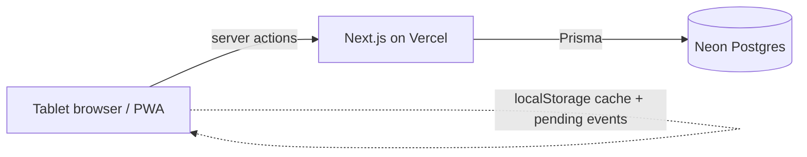

# הכלבלב של רז 🐶

A tablet game app that helps Raz, who is non-verbal and autistic, practise communication. An original puppy character reacts to his voice and touch, and he earns stars for every attempt.

## Games

| Screen | What it practises | How it works |
|---|---|---|
| **Home (talking dog)** | Vocalising | The mic picks up any sound Raz makes (volume only, no speech recognition). The dog repeats it in a funny high voice. One ⭐ every 4 seconds at most. Tap the head or belly for a reaction. |
| **Feeding** 🍖 | Understanding, choosing | The dog "thinks" of a food and Raz picks the matching picture (2–4 options). After 2 misses the right answer pulses (errorless learning). 5 rounds, then a celebration and 3 bonus ⭐. |
| **Shop** 🛍️ | Reward | Spend stars on hats and glasses for the dog. Tap an owned item to put it on or take it off. |

Designed for a noise-sensitive child: quiet synthesized sounds, no buzzers for mistakes, no flashing, no time pressure.

## Parent area

To open it, press and hold the faint ⚙️ in the bottom corner for 2 seconds, then enter the parent password. From there you can:

- See progress for the last 14 days: sounds made, correct/wrong feeds, completed games.
- Change settings: volume, mic sensitivity, echo on/off, speaking food names, number of options, and a session time limit after which the dog falls asleep.
- Adjust the star count.

## Access control

The **games are open** and need no login, because a 7-year-old shouldn't hit a password screen. Game writes are limited to the single `raz` player, and every input is checked against a schema.

`/parent` and every parent server action are behind a **shared-password gate** (`SITE_PASSWORD`). Both `middleware.ts` and `lib/parent-guard.ts` check it, and both **fail closed**: if the variable is unset, nobody gets in.

## Architecture



- **Local-first.** Every star or purchase is applied and cached on the device immediately, then synced in the background with `saveProgress`. The game never waits on the network. Unsynced events survive reloads.
- **Echo** (`lib/audio/echo.ts`): Web Audio ScriptProcessor feeds an energy-based voice-activity detector (`lib/audio/vad.ts`, a pure function with unit tests). The captured clip is played back at 1.5× speed. Mic input is ignored during playback so the dog never repeats itself.
- **Dog** (`components/Dog.tsx`): an original SVG character animated with Framer Motion, with moods `idle / listen / talk / happy / giggle / eat / hmm / dance / sleep`.

## Stack

Next.js (App Router) · TypeScript · Tailwind v4 · Framer Motion · Prisma 5.22.0 · Neon Postgres · Vitest · Vercel.

```bash
pnpm install
cp .env.example .env   # fill DATABASE_URL, DATABASE_URL_UNPOOLED, SITE_PASSWORD
pnpm db:push
pnpm dev
```

`pnpm build` runs `prisma generate` and then the test suite before `next build`, so a failing test blocks the deploy.

## Hosting & CI/CD

Vercel builds every push to `main` (Vercel's GitHub integration). The environment variables `DATABASE_URL`, `DATABASE_URL_UNPOOLED` and `SITE_PASSWORD` live in the Vercel project.

## Installing on the tablet

Open the site in Safari (iPad) or Chrome (Android), choose **Add to Home Screen**, and launch it from the icon to get full screen. Allow microphone access the first time.
